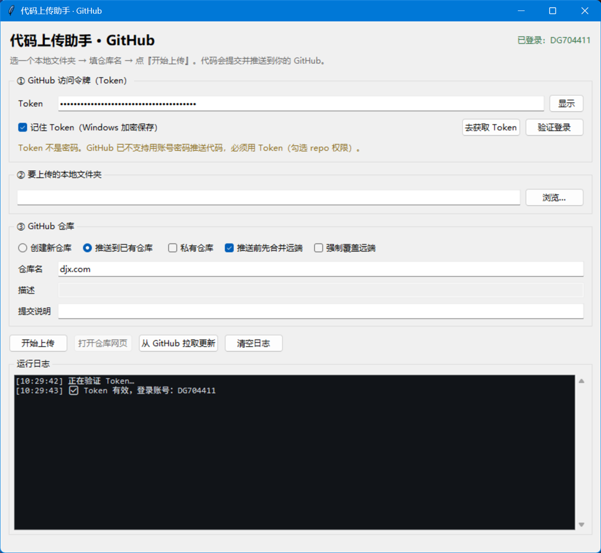

# 代码上传助手 · GitHub（GitPusher）

> **选文件夹 → 填仓库名 → 点一下，代码就上了 GitHub。** 不用打开网页，不用敲 git 命令。

Windows 桌面小工具，把本地文件夹一键提交并推送到 GitHub 仓库。
纯 Python 标准库实现，**零第三方运行时依赖**。



---

## 为什么会有它

GitHub 对不熟 git 的人有几个硬门槛：

1. 网页上没法直接拖一个文件夹上去（只能一个个传文件）
2. 命令行 `git init / add / commit / push` 要背
3. 2021 年起**账号密码不能推代码**，必须用 Personal Access Token，很多人第一次就卡在这
4. 仓库里已经有 README 或 `Initial commit` 时，第一次推送会被 `non-fast-forward` 拒掉

这个工具把 1-4 全部包进一个界面：粘一次 Token，之后每次只需要选文件夹、点按钮。

## 特性

- 🖱 **一键上传**：自动建仓库 → 生成 `.gitignore` → `init/add/commit/push`
- 🔐 **Token 加密保存**：Windows DPAPI（`CryptProtectData`），配置文件权限收紧到仅当前用户
- 🔀 **推送前自动合并远端**：先判断祖先关系，落后就快进、分叉就 rebase，**不再被「推送被拒绝」卡住**
- ♻️ **推送被拒自动重试**：识别 `non-fast-forward` 后自动合并再推一次
- ⬇️ **「从 GitHub 拉取更新」**：只拉不推，把网页上改的东西同步回本地
- 🛡 **合并前必备份**：建 `gitpusher-backup-<时间戳>` 分支；冲突自动 `--abort` 还原
- 📏 **上传前体检**：单文件 >100MB（GitHub 硬上限）直接拦下，>45MB 提醒
- ⌨️ **命令行版**：`python -m gitpusher.cli`，可脚本化 / 无界面环境
- ✅ **13 项自动化测试** + GitHub Actions CI（Windows & Linux × Python 3.11 & 3.12）

## 快速开始（免安装）

1. 装好 [Python 3.10+](https://www.python.org/downloads/) 和 [Git for Windows](https://git-scm.com/download/win)
2. 下载或克隆本仓库
3. 双击 **`run.bat`**（或中文名的 `启动.bat`，或直接双击 `GitPusher.pyw`）

### 第一步：拿一个 Token（只需一次）

界面里点 **「去获取 Token」**，会打开权限已预勾选的页面：

- 确认已登录你自己账号 → 滚到最底 **Generate token**
- 复制 `ghp_` 开头那串（只显示一次）→ 粘回软件 → 点「验证登录」

> 也可以手动打开 <https://github.com/settings/tokens/new?scopes=repo&description=GitPusher>
> 只需要勾 **`repo`** 这一项。

### 第二步：上传

1. **② 要上传的本地文件夹** → 「浏览…」（仓库名会自动填好）
2. **③ GitHub 仓库** → 保持「创建新仓库」，需要就勾「私有仓库」
3. 点 **「开始上传」**，等日志出现 `✅ 上传完成`

仓库名已存在时，切到「推送到已有仓库」；「推送前先合并远端」保持默认勾选即可。

### 第三步：同步（可选）

在网页上直接改过文件？点 **「从 GitHub 拉取更新」**，把改动拉回本地。

## 安装为命令行工具

```bash
git clone https://github.com/DG704411/gitpusher.git
cd gitpusher
python -m pip install -e .
```

之后可以用：

```bash
gitpusher --folder D:\mycode --repo my-project       # 命令行上传
python -m gitpusher                                  # 打开桌面界面
```

## 命令行用法

```bat
rem Token 已在界面里保存过，可省略 --token
python -m gitpusher.cli --folder D:\mycode --repo my-project
python -m gitpusher.cli --folder . --repo my-project --existing
python -m gitpusher.cli --folder . --repo my-project --pull-only
python -m gitpusher.cli --folder . --repo my-project --public --yes
```

| 参数 | 说明 |
|---|---|
| `--folder` | 本地文件夹（必填） |
| `--repo` | GitHub 仓库名（必填） |
| `--token` | 不填则读 `GITHUB_TOKEN` 环境变量或界面里保存的 |
| `--mode create\|existing` | 新建仓库 / 推到已有仓库（默认 `create`） |
| `--public` | 默认建私有，加此项改公开 |
| `--pull-only` | 只把远端更新合并到本地，不上传 |
| `--no-auto-merge` | 关闭自动合并（推送被拒时不自动处理） |
| `--force` | 强制推送（覆盖远端） |
| `--yes` | 跳过交互确认 |

也可以用 `cli.bat` 包一层，省得写 `PYTHONPATH`。

## 自动合并是怎么做到不丢代码的

当远端和本地都有新提交时：

1. 建备份分支 `gitpusher-backup-20260101-120000`（指向合并前的本地状态）
2. 把本地提交 rebase 到远端最新提交之后
3. 冲突时自动 `git rebase --abort` 还原，**本地一个字节都不变**，然后提示你去处理

想手动回退：`git reset --hard gitpusher-backup-<时间戳>`

## 项目结构

```
.
├─ GitPusher.pyw              # 双击启动器（把 src 加入 sys.path 后开界面）
├─ run.bat / 启动.bat          # Windows 启动脚本
├─ cli.bat                    # 命令行包装
├─ src/gitpusher/
│  ├─ __init__.py             # 版本号唯一来源
│  ├─ __main__.py             # python -m gitpusher
│  ├─ core.py                 # GitHub API + git 流水线（无界面，可单测）
│  ├─ secure_store.py         # DPAPI 加密存储
│  ├─ gui.py                  # tkinter 界面
│  └─ cli.py                  # 命令行
├─ tests/
│  ├─ test_core.py            # pytest 风格用例
│  └─ run_tests.py            # 零依赖运行器（没装 pytest 也能跑）
├─ docs/screenshot.png
├─ pyproject.toml
├─ CHANGELOG.md / CONTRIBUTING.md / SECURITY.md / LICENSE
└─ .github/workflows/ci.yml
```

## 测试

```bat
python tests\run_tests.py     rem 零依赖，推荐
python -m pytest -v           rem 需要 pip install -e .[dev]
```

两种方式跑的是同一套 13 个用例。标了 `network` 的用例会访问 GitHub API，
但**只用假 Token**，预期就是认证失败，不会写任何真实仓库。

## 安全

详见 [SECURITY.md](SECURITY.md)。要点：

- Token 只出现在推送时的一次性 `http.extraHeader` 里，**不写 `.git/config`**、不进 credential store、不进日志
- 所有 git 子进程强制 `GIT_TERMINAL_PROMPT=0`，绝不卡在密码交互上
- 提交身份只写入目标仓库的局部配置，不动你的全局 git 配置
- `.gitignore` 只在你**没有**时生成，已有内容绝不覆盖
- 不加隐式 `--force`

## 常见问题

| 现象 | 原因 / 解决 |
|---|---|
| `Token 无效或已过期` | 复制不全或已被删除 → 重新生成 |
| `权限不足或触发频率限制` | Token 没勾 `repo` → 重新生成并勾上 |
| `仓库名已存在` | 改模式为「推送到已有仓库」，或换个名字 |
| `推送被拒绝` | 很少见（已自动合并）。仍出现就勾「强制覆盖远端」，或先点「从 GitHub 拉取更新」 |
| `远端改动与本地冲突` | 同一个文件两边都改了。本地已还原，未丢东西；手动解决冲突或用强制覆盖 |
| `找不到 git 命令` | 装 [Git for Windows](https://git-scm.com/download/win) |
| 界面打不开 | 在 `cmd` 里跑 `python GitPusher.pyw` 看报错 |

## 平台支持

| 功能 | Windows | macOS / Linux |
|---|---|---|
| 图形界面 | ✅ | ⚠️ 理论可跑（tkinter），未测试 |
| 命令行 | ✅ | ✅（Token 降级为 base64 保存，见 `secure_store`） |
| Token DPAPI 加密 | ✅ | ❌ |

## 许可证

[MIT](LICENSE) © 2026 DG704411

本项目按「现状」提供。它会在你授权下创建仓库并推送代码——请先在测试仓库上试用，确认行为符合预期再用于重要项目。
